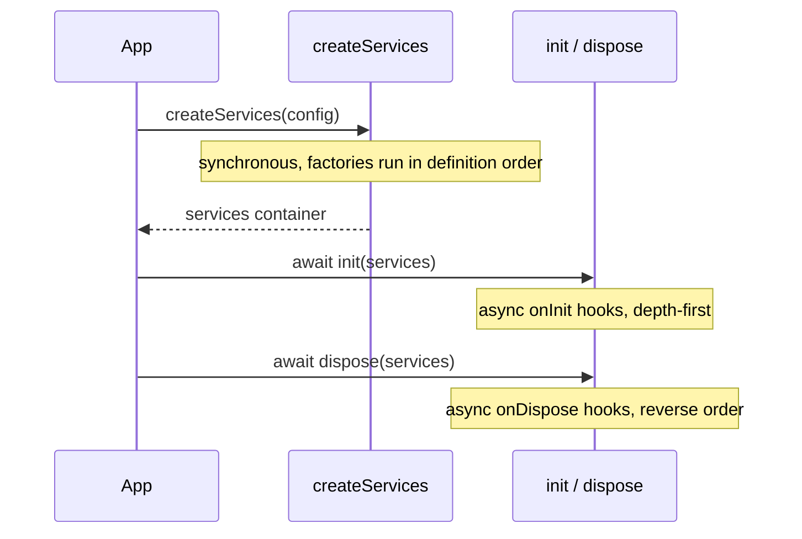

# Introduction

## Why Laminar

Large backends tend to grow in strata: configuration at the bottom, then infrastructure services (database, mail), business modules, and finally the transport layer (HTTP, RPC). Laminar makes those strata a first-class, typed concept.

| Idea | What it means |
|---|---|
| Explicit factories | A component is created by a plain function you write and call order you control. |
| Typed boundaries | Each layer declares what it receives; `PublicLayer<T>` hides what must not leak. |
| Synchronous assembly | Building a container never awaits. Asynchronous work lives in lifecycle hooks. |
| No global state | Every call of a creator builds a fresh container; there is no singleton registry. |

> [!info] Not a decorator framework
> Laminar does not scan classes or use metadata. If you prefer annotations and automatic graph resolution, Laminar is deliberately not that.

## The two-phase model

Laminar separates *building* an object graph from *starting* it.



1. **Assembly** – synchronous, pure wiring.
2. **Initialization** – asynchronous, explicit (`await init(layer)`).
3. **Disposal** – asynchronous, explicit (`await dispose(layer)`).

> [!tip] Rule of thumb
> If it needs `await`, it belongs in `onInit`. If it can be a plain value or closure, it belongs in the factory.

## Installation

```sh
npm install @atom-forge/laminar
```

The package is ESM-only and ships its own type declarations.
