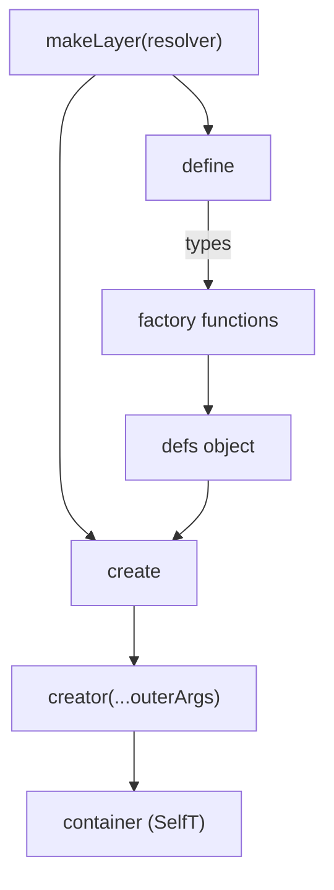

# Layers and factories

## Layer

A **layer** is an object whose properties are components (services, modules, endpoints…). In Laminar a layer is described by a type of three parameters and produced by `makeLayer`.

```ts
type MyLayer = Layer<OuterArgs, SelfT, FactoryArgs>;
```

| Parameter | Meaning |
|---|---|
| `OuterArgs` | Arguments of the **creator** function (what the caller passes in). |
| `SelfT` | Type of the container that is built. |
| `FactoryArgs` | Arguments every **factory** of the layer receives. |

`makeLayer` returns a tuple `[define, create]`:

- `define(factory)` – identity helper that types a factory.
- `create(defs, options?)` – takes an object of factories and returns the **creator**.



## The resolver

The resolver maps what the creator was called with plus the container under construction to the argument tuple of the factories:

```ts
makeLayer<FromLayer<ModulesLayer>>(
  ([config, services], self) => [config, services as PublicLayer<Services>, self],
);
```

A layer that does not reference itself simply omits `self` from the tuple.

## Factory

A factory builds **one** component and returns it synchronously.

> [!warning] No dependency graph
> Factories run in `Object.keys(defs)` order. Laminar does not sort them by dependency and does not make them lazy. Prefer non-numeric keys, because integer-like keys are reordered by JavaScript.

### Self-reference

Because factories get the shared container, a component can use its siblings:

```ts
export const email = defineService((config, services) => ({
  send: async (to: string, text: string) => {
    await services.database.query('log email'); // resolved at call time
  },
}));
```

> [!danger] Access siblings later, not during construction
> `services.database` does not exist yet while `email` is being built if `database` comes after it. Touch siblings **inside methods or hooks**. Destructuring a not-yet-built component captures `undefined`.

```ts
// ❌ captured too early
const { database } = services;

// ✅ resolved when the function runs
const send = () => services.database.query('…');
```

## The `assemble` option

`create` accepts a second argument with a callback that runs synchronously right after the layer is complete:

```ts
const createApi = apiCreatorFactory(defs, {
  assemble: (self, config, modules) => {
    registerRoutes(self); // imperative setup
  },
});
```

It receives the finished container followed by the factory arguments. Use it for route or middleware registration instead of writing a wrapper function.

## One container per call

Each call of a creator runs every factory again and returns a new container. This makes tests simple: build a fresh container per test.
