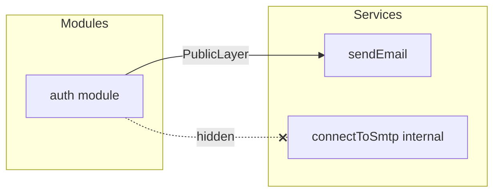

# Internal visibility

Some members of a component are implementation details: a connection pool, a helper, a policy object. `internal(...)` marks them so that **other layers** do not see them, while the **same layer** still can.

```ts
import { internal } from '@atom-forge/laminar';

export const emailService = defineService((config) => {
  async function connectToSmtp() { /* … */ }
  async function sendEmail(to: string, body: string) {
    await connectToSmtp();
  }

  return {
    sendEmail,
    connectToSmtp: internal(connectToSmtp),
  };
});
```

## `PublicLayer<T>`

`PublicLayer<T>` recursively removes every property marked `internal`. Function signatures are preserved. A layer that consumes another layer types its factory argument as `PublicLayer<…>`:

```ts
type ModulesLayer = Layer<
  [Config, Services],
  Modules,
  [Config, PublicLayer<Services>, Modules]
>;
```



## Who decides

The **parent** marks a child internal, not the child itself. The child stays reusable:

```ts
// conferenceModule
return {
  public: conferencePublicModule(),
  policy: internal(conferencePolicyModule()), // the parent decides
};
```

> [!warning] Compile-time only
> `internal(value)` returns the very same value. It is **not** a runtime filter and **not** a security boundary. The property is still present on the object at runtime; it is simply invisible to the type checker through `PublicLayer<T>`.

> [!tip] When it is enforced
> Visibility is enforced only where the factory arguments are typed as `PublicLayer<T>` and the creator argument is cast accordingly in the resolver (`services as PublicLayer<Services>`).
