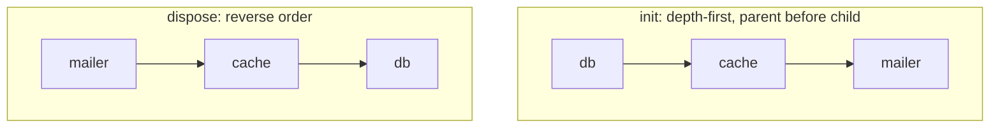

# Lifecycle

Assembly is synchronous, but real components need asynchronous startup (open a pool, ping a server) and shutdown. Laminar offers two hooks and two runners.

## Declaring hooks

Spread the result of `onInit` / `onDispose` into the object a factory returns. No wrapper, no extra argument.

```ts
export const prismaService = defineService((config) => {
  const pool = new Pool(config.database);
  return {
    db: new PrismaClient({ adapter: new PrismaPg(pool) }),
    ...onInit(async () => { await pool.query('SELECT 1'); }),
    ...onDispose(() => pool.end()),
  };
});
```

Components without hooks are skipped silently.

## Running hooks

```ts
const services = createServices(config);
await init(services);

// … application runs …

await dispose(services);
```

`createServices` never runs `onInit` for you.

## Order



For a flat layer this is definition order for `init` and its reverse for `dispose`.

Between layers the caller is responsible for ordering:

```ts
await init(services);
await init(modules);

await dispose(modules);
await dispose(services);
```

> [!tip] Rule
> Initialize lower layers first; dispose them last.

## How traversal works

Every factory result that is an object gets branded internally with a `COMPONENT` symbol. `init` / `dispose` walk **only branded objects**, so a Prisma model, a `Date` or any other arbitrary data inside a component is never traversed.

## Behaviour to know

> [!warning] Errors
> An error stops the current `init` / `dispose` call. There is no rollback and the remaining components are not cleaned up.

> [!warning] Repeated calls
> Calling `init` twice runs the hooks twice. Idempotency is your responsibility.

> [!warning] One hook per kind per object
> Spreading two `onInit` results into the same object overwrites the first one. Combine them in a single function.

> [!danger] No cycle detection
> The walker does not detect cycles or deduplicate. Keep component references in closures instead of cyclic enumerable properties. A component reachable by two paths will have its hooks called twice.

> [!note] Closure dependencies are invisible
> Laminar does not discover dependencies captured in closures. That is why you order layers yourself.
