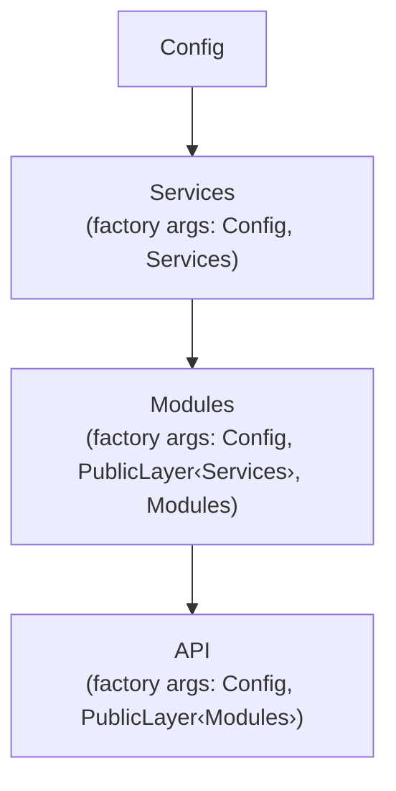

# A layered application

A typical backend is built in the order **Config → Services → Modules → API**. This chapter wires the first three.



## Layer definitions

```ts
// layers.ts
import { type FromLayer, type Layer, makeLayer, type PublicLayer } from '@atom-forge/laminar';
import type { Services } from './services';
import type { Modules } from './modules';

export type Config = { smtp: string };

type ServicesLayer = Layer<[Config], Services, [Config, Services]>;
export const servicesLayer: ServicesLayer = makeLayer<FromLayer<ServicesLayer>>(
  ([config], self) => [config, self],
);
export const [defineService, serviceCreatorFactory] = servicesLayer;

type ModulesLayer = Layer<[Config, Services], Modules, [Config, PublicLayer<Services>, Modules]>;
export const modulesLayer: ModulesLayer = makeLayer<FromLayer<ModulesLayer>>(
  ([config, services], self) => [config, services as PublicLayer<Services>, self],
);
export const [defineModule, moduleCreatorFactory] = modulesLayer;
```

> [!info] Reading the types
> - **Services** receive `Config` and their own container (self-reference).
> - **Modules** receive the *public* view of `Services` and their own container.
> - An **API** layer would receive only `PublicLayer<Modules>`; it ignores `_self` because endpoints rarely call each other.

## Services

```ts
// services.ts
import { internal, type Unit } from '@atom-forge/laminar';
import { defineService, serviceCreatorFactory } from './layers';

export const database = defineService(() => {
  const pool = {}; // set up the pool
  return {
    query: async (sql: string) => { /* … */ },
    pool: internal(pool), // hidden from Modules
  };
});

export const email = defineService((config, services) => ({
  send: async (to: string, text: string) => {
    await services.database.query('log email');
  },
}));

export type Services = {
  database: Unit<typeof database>;
  email: Unit<typeof email>;
};

export const createServices = serviceCreatorFactory({ database, email });
```

## Modules

```ts
// modules.ts
import { type Unit } from '@atom-forge/laminar';
import { defineModule, moduleCreatorFactory } from './layers';

export const auth = defineModule((config, services) => ({
  login: async (user: string) => {
    await services.email.send(user, 'Welcome!');
    // services.database.pool → compile error: marked internal
  },
}));

export type Modules = { auth: Unit<typeof auth> };

export const createModules = moduleCreatorFactory({ auth });
```

## Boot sequence

```ts
// app.ts
import { init, dispose } from '@atom-forge/laminar';

const config = { smtp: 'smtp.example.com' };

const services = createServices(config);
const modules = createModules(config, services);

await init(services);
await init(modules);

await modules.auth.login('user@example.com');

await dispose(modules);
await dispose(services);
```

> [!example] Wrapping it up
> Many apps expose a single `createApp(config)` that performs the assembly, returns `{ services, modules, api }` and a `dispose()` closure that tears layers down in reverse order.
