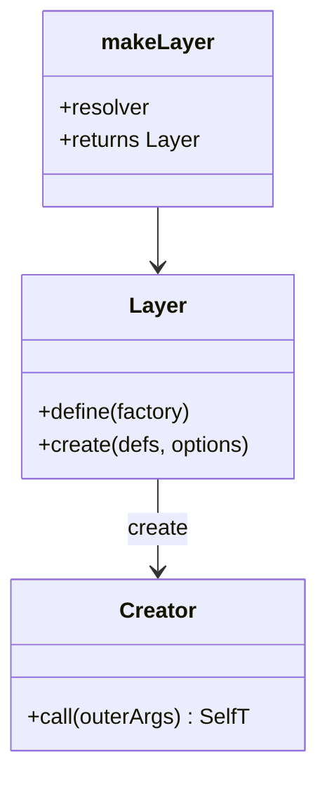

# API reference

All exports come from `@atom-forge/laminar`.

## Types

### `Layer<OuterArgs, SelfT, FactoryArgs>`

A tuple `[define, create]`.

| Element | Signature |
|---|---|
| `define` | `<T>(factory: (...args: FactoryArgs) => T) => (...args: FactoryArgs) => T` |
| `create` | `(defs, options?) => (...outerArgs: OuterArgs) => SelfT` |

`defs` is an object with one factory per key of `SelfT`. `options.assemble` has the form `(self: SelfT, ...factoryArgs) => void`.

### `FromLayer<T>`

Extracts `[OuterArgs, SelfT, FactoryArgs]` from a `Layer<…>` type. Used as `makeLayer<FromLayer<MyLayer>>(…)`.

### `Unit<T>`

`ReturnType<T>` for a factory function.

### `PublicLayer<T>`

Recursively removes properties marked with `internal(...)`. Functions are kept as they are.

## Functions

### `makeLayer<L>(resolver)`

```ts
makeLayer<FromLayer<MyLayer>>((outerArgs, self) => factoryArgs)
```

Returns `[define, create]`. Also overloaded with three separate type parameters `<OuterArgs, SelfT, FactoryArgs>`.

### `internal(value)`

Returns `value` unchanged, typed so that `PublicLayer` omits it.

### `onInit(fn)` / `onDispose(fn)`

`fn: () => void | Promise<void>`. Returns an object to spread into a factory result.

### `init(layer)` / `dispose(layer)`

`(layer: object) => Promise<void>`. Walks branded components and awaits hooks sequentially.

| | `init` | `dispose` |
|---|---|---|
| Order | depth-first, parent first | reverse of `init` |
| On error | stops, no rollback | stops, no rollback |
| Takes | a single layer | a single layer |

> [!note] Single layer
> Since 0.4.0 both functions take exactly one layer. Call them once per layer.

## Summary


