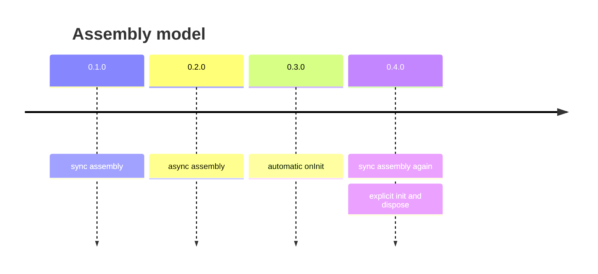

# Release history and migration

| Version | Date | Highlights |
|---|---|---|
| 0.4.3 | 2026-10-07 | Release. |
| 0.4.2 | 2026-10-07 | `README-AI.md`, `AGENT.md`, documentation fixes. |
| 0.4.1 | 2026-06-16 | `assemble` option for creators. |
| 0.4.0 | 2026-06-16 | `Unit<T>`; synchronous assembly; explicit `init` / `dispose`. |
| 0.3.0 | 2026-06-16 | `onInit` / `onDispose`; component branding. |
| 0.2.0 | 2026-06-16 | Async assembly (later rolled back). |
| 0.1.0 | – | Initial release. |



## Migrating to 0.4

> [!warning] Breaking changes in 0.4.0
> - Creators return the container directly, not a `Promise`.
> - `makeLayer` no longer runs `onInit` automatically (`skipInit` is gone).
> - `init` and `dispose` accept a **single** layer.

```ts
// before (0.2 / 0.3)
const services = await createServices(config);

// after (0.4)
const services = createServices(config);
await init(services);
```

```ts
// before
await dispose(modules, services);

// after
await dispose(modules);
await dispose(services);
```

> [!tip] Async factories
> If a factory used to `await` something, move that part into `onInit` and keep the factory itself synchronous.
