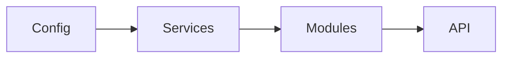

# Laminar

**Laminar** (`@atom-forge/laminar`) is a small TypeScript library for building applications out of explicit **layers**: *Config → Services → Modules → API*. Every layer is assembled from plain factory functions, and the boundaries between layers are checked by the compiler. There are no decorators, no reflection and no hidden container.

> [!abstract] What you will learn
> - how a layer is described, created and assembled,
> - how to hide implementation details from neighbouring layers with `internal`,
> - how to run asynchronous startup and shutdown with `onInit` / `onDispose`,
> - how to wire a complete multi-layer application,
> - which traps to avoid.

## Where to start

- New to Laminar? Read [[01-introduction]] and then [[02-getting-started]].
- Looking for a signature? Go straight to [[07-api-reference]].
- Something behaves strangely? See [[08-pitfalls]].
