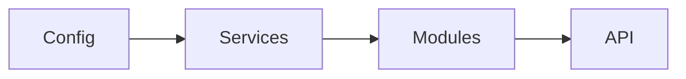
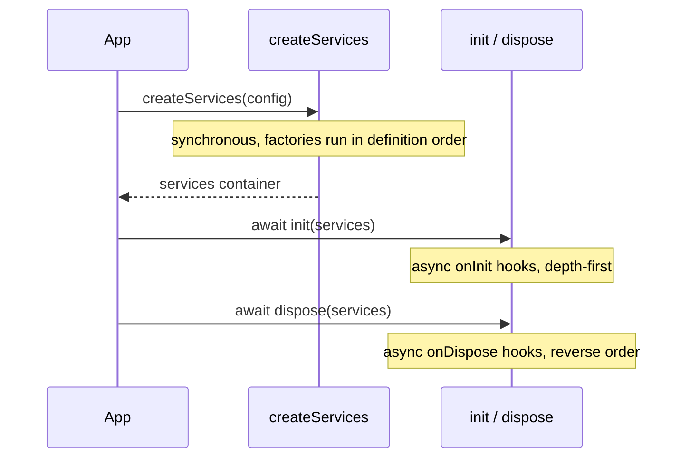

# Laminar

**Laminar** (`@atom-forge/laminar`) is a small TypeScript library for building applications out of explicit **layers**: *Config → Services → Modules → API*. Every layer is assembled from plain factory functions, and the boundaries between layers are checked by the compiler. There are no decorators, no reflection and no hidden container.

> [!abstract] What you will learn
> - how a layer is described, created and assembled,
> - how to hide implementation details from neighbouring layers with `internal`,
> - how to run asynchronous startup and shutdown with `onInit` / `onDispose`,
> - how to wire a complete multi-layer application,
> - which traps to avoid.

## Who this book is for

TypeScript developers building backends (or any larger application) who want explicit, compiler-checked boundaries between configuration, infrastructure, business logic and transport — without a decorator-based DI framework. Basic TypeScript generics are assumed.

## Why Laminar

Large backends tend to grow in strata: configuration at the bottom, then infrastructure services (database, mail), business modules, and finally the transport layer (HTTP, RPC). Laminar makes those strata a first-class, typed concept.

| Idea | What it means |
|---|---|
| Explicit factories | A component is created by a plain function you write and call order you control. |
| Typed boundaries | Each layer declares what it receives; `PublicLayer<T>` hides what must not leak. |
| Synchronous assembly | Building a container never awaits. Asynchronous work lives in lifecycle hooks. |
| No global state | Every call of a creator builds a fresh container; there is no singleton registry. |

> [!info] Not a decorator framework
> Laminar does not scan classes or use metadata. If you prefer annotations and automatic graph resolution, Laminar is deliberately not that.

## The two-phase model

Laminar separates *building* an object graph from *starting* it.

1. **Assembly** – synchronous, pure wiring.
2. **Initialization** – asynchronous, explicit (`await init(layer)`).
3. **Disposal** – asynchronous, explicit (`await dispose(layer)`).

> [!tip] Rule of thumb
> If it needs `await`, it belongs in `onInit`. If it can be a plain value or closure, it belongs in the factory.

## Reading guide

- New to Laminar? Start with [[getting-started]], then [[layers-and-factories]] and [[lifecycle]].
- Wiring a whole application? See [[layered-application]].
- Looking for a signature? Go straight to [[api-reference]].
- Something behaves strangely? See [[pitfalls]].
- Upgrading from an earlier version? Read [[upgrading]].
