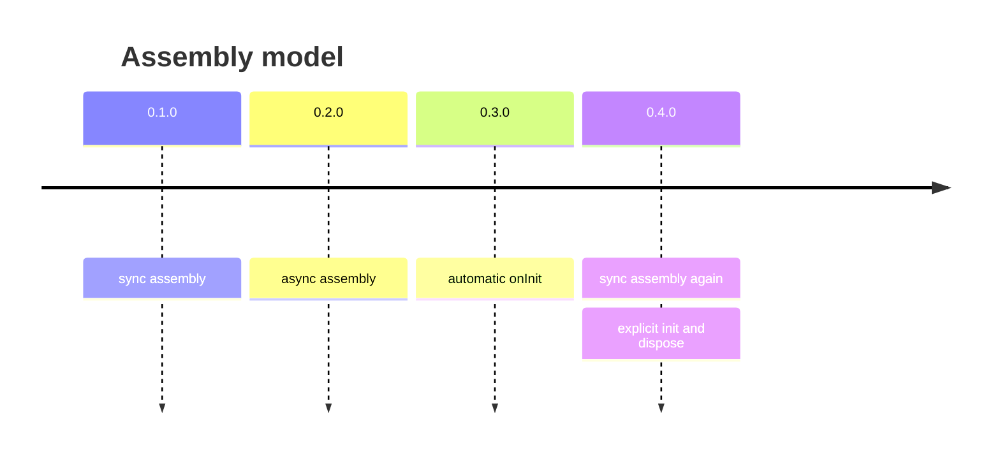

# Upgrading

This page describes, version by version, what changed in behaviour and what you have to do in your application. The list of releases is at the end of the chapter.

## From 0.4.x to 0.5.0

0.5.0 makes the lifecycle (`onInit` / `onDispose`, `init` / `dispose`) behave the way the documentation always described it. The public API — exported names and their type signatures — is unchanged, and so is assembly. Some behaviour changed, so check the sections below.

> [!abstract] In short
> - Hooks of **nested components** now run.
> - Factory results are **no longer modified**; frozen objects and functions can be components.
> - Each component is visited **once** per `init` / `dispose` call; cycles are safe.
> - `dispose` **runs every hook**, even after an error, then throws.
> - `define` returns a **wrapper**, not your original function.

### Nested components now take part in the lifecycle

Earlier only the factories listed in `create(defs)` produced components. A defined factory called *inside* another factory returned a plain object, and its hooks were silently skipped:

```ts
const policyModule = defineModule((config, services, modules) => ({
  canEdit,
  ...onDispose(() => cleanup()), // 0.4: never ran · 0.5: runs
}));

const conferenceModule = defineModule((config, services, modules) => ({
  public: conferencePublicModule(config, services, modules),
  policy: internal(policyModule(config, services, modules)),
}));
```

From 0.5.0 every value returned by a defined factory is a component, wherever it is called. `init` reaches the nested component after its parent, `dispose` before it.

**What to do:** check that the hooks of your nested components should run. If a parent hook called a child's init or cleanup by hand because the child's own hook did not run, that code now runs **twice** — delete the manual call and let the child's own `onInit` / `onDispose` do it.

### Factory results are no longer modified

0.4 marked every factory result with a hidden `laminar.component` symbol property. 0.5.0 keeps track of components in an internal registry and leaves the objects untouched. As a result:

- **Frozen and non-extensible results work.** A factory returning `Object.freeze({ … })` used to throw `TypeError` during assembly.
- **Shared objects stay clean.** A factory that returns an existing singleton (a client, a module-level object) no longer gets a symbol added to it.
- **Functions can be components.** A factory returning a function with hooks attached now has its hooks run:

  ```ts
  const handler = defineApi(() =>
    Object.assign((req: Request) => respond(req), onDispose(() => flush())),
  );
  ```

In 0.4 the marker was a normal own property, so a spread copy (`{ ...services.db }`) carried it and was treated as a component. Now only the object returned by the factory itself is a component. Objects that were never returned by a factory — configuration, domain data, a `Date` — are still not traversed, even if they contain an `onInit` / `onDispose` result.

**What to do:** if you relied on a spread or `Object.assign` copy of a component being initialized or disposed, return the object you want managed from a factory instead. Code that read the `laminar.component` symbol from a result must stop doing so; the symbol no longer exists.

### Each component is visited once

`init` and `dispose` now remember which components they have already visited during the call:

| Situation | 0.4 | 0.5.0 |
|---|---|---|
| A component reachable through two properties | hooks ran twice | hooks run once |
| A component referencing itself or a cycle of components | infinite recursion, stack overflow | handled, each hook once |

Calling `init` or `dispose` **twice yourself** still runs the hooks twice.

**What to do:** if a component is reachable through several properties and your code relied on its hooks running more than once, call that logic explicitly instead. Idempotency guards added only because of the double calls are no longer needed, but they do no harm.

### `dispose` runs every hook, even after an error

In 0.4 the first failing `onDispose` stopped `dispose`; the remaining components were not cleaned up. In 0.5.0 every hook runs, then the error is thrown:

| Failed hooks | What `dispose` throws |
|---|---|
| none | nothing |
| one | that error, unchanged (same instance) |
| several | an `AggregateError`; `errors` holds them in the order the hooks ran |

```ts
try {
  await dispose(modules);
} catch (error) {
  const errors = error instanceof AggregateError ? error.errors : [error];
  for (const e of errors) logger.error('dispose failed', e);
}
```

`init` is unchanged: it stops at the first error, without rollback.

**What to do:** where you inspect the error thrown by `dispose`, handle `AggregateError` as shown above. Code that only logs or rethrows needs no change. Hooks that assumed an earlier failure would stop the remaining ones from running must be able to run on their own.

### `define` returns a wrapper

`defineService(fn)` (and every other `define`) now returns a new function that calls `fn` and registers its result. The type is identical, but:

- `defineService(fn) === fn` is now `false`;
- the returned function's `name` and `length` differ from `fn`'s.

**What to do:** only if your code compares factories by identity or reads these properties — keep the value returned by `define` and use that everywhere instead of the function you passed in.

### Upgrade checklist

- [x] Remove manual calls to child cleanup or init that compensated for nested hooks not running.
- [x] Check that nested components' hooks running now is what you want.
- [x] Handle `AggregateError` where you inspect errors thrown by `dispose`.
- [x] Do not rely on spread copies of components being initialized or disposed.
- [x] Do not compare factories with the functions passed to `define`.

## From 0.2 / 0.3 to 0.4

> [!warning] Breaking changes in 0.4.0
> - Creators return the container directly, not a `Promise`.
> - `makeLayer` no longer runs `onInit` automatically (`skipInit` is gone).
> - `init` and `dispose` accept a **single** layer.

```ts
// before (0.2 / 0.3)
const services = await createServices(config);

// after (0.4)
const services = createServices(config);
await init(services);
```

```ts
// before
await dispose(modules, services);

// after
await dispose(modules);
await dispose(services);
```

> [!tip] Async factories
> If a factory used to `await` something, move that part into `onInit` and keep the factory itself synchronous.

## Release history

| Version | Date | Highlights |
|---|---|---|
| 0.5.0 | 2026-11-05 | Nested component hooks, no mutation of factory results, `dispose` runs every hook. |
| 0.4.3 | 2026-10-07 | Release. |
| 0.4.2 | 2026-10-07 | `README-AI.md`, `AGENT.md` (now `AGENTS.md`), documentation fixes. |
| 0.4.1 | 2026-06-16 | `assemble` option for creators. |
| 0.4.0 | 2026-06-16 | `Unit<T>`; synchronous assembly; explicit `init` / `dispose`. |
| 0.3.0 | 2026-06-16 | `onInit` / `onDispose`; component branding. |
| 0.2.0 | 2026-06-16 | Async assembly (later rolled back). |
| 0.1.0 | – | Initial release. |


